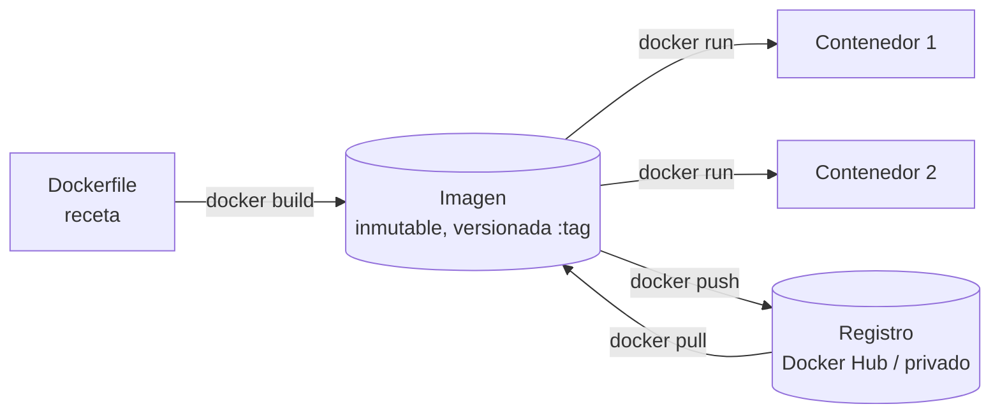
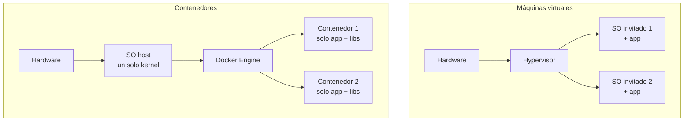
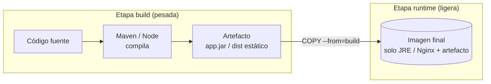
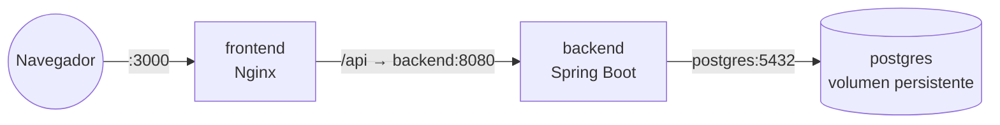
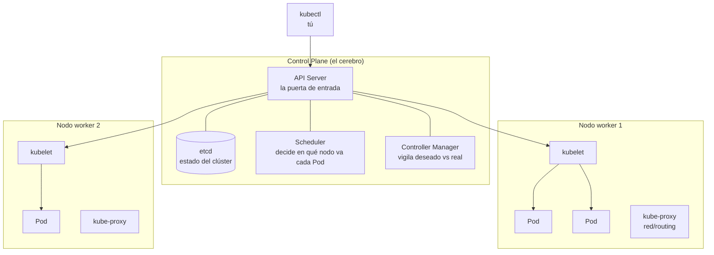
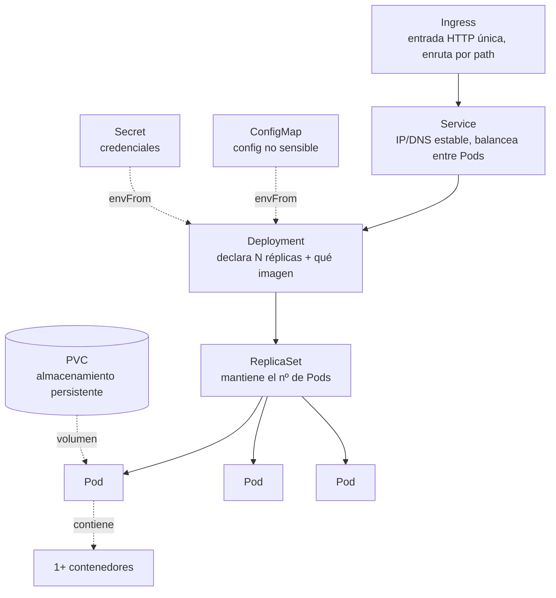
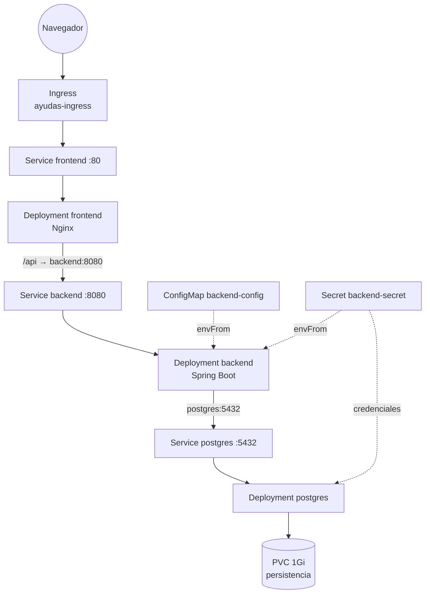
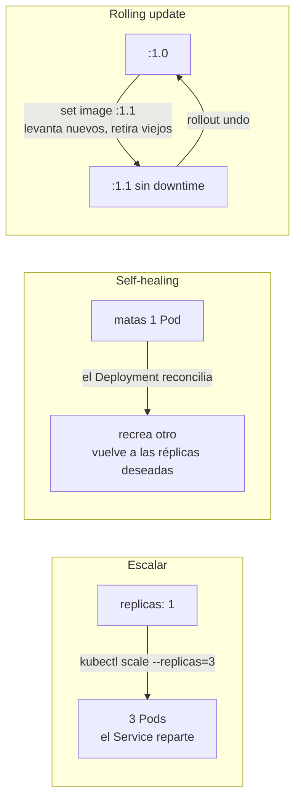

# Docker y Kubernetes — diagramas y explicaciones breves

> Chuleta visual para tener el modelo mental claro en 10 minutos. Los diagramas son Mermaid
> (se renderizan en VS Code con la vista previa de Markdown, y en GitHub/GitLab).
> Ejemplos anclados a este proyecto (Ayudas GV): backend Spring Boot + frontend React/Nginx + PostgreSQL.

---

## 1. Qué es Docker (en una frase)

**Docker empaqueta una aplicación con todo lo que necesita para ejecutarse (código, runtime, librerías,
config) en una _imagen_ inmutable. De esa imagen se arrancan _contenedores_: procesos aislados que corren
igual en cualquier máquina.** Resuelve el "en mi máquina funciona".

- **Imagen**: plantilla de solo lectura, identificada por `nombre:tag` (ej. `ayudas-gv-backend:1.0`).
- **Contenedor**: una instancia en ejecución de una imagen. Efímero: si se borra, se pierde lo no persistido.
- **Registro**: donde se guardan/comparten las imágenes.

---

## 2. Contenedor vs máquina virtual

La diferencia clave que suelen preguntar: **el contenedor comparte el kernel del host; la VM emula un SO
completo.** Por eso el contenedor arranca en segundos y pesa MB, no GB.

---

## 3. Multi-stage build (el Dockerfile de este proyecto)

Patrón que usan ambos Dockerfiles: **una etapa compila, otra solo se lleva el resultado.** La imagen final
no arrastra Maven/Node ni el código fuente → más pequeña y más segura.

- Backend: `maven` compila el `.jar` → imagen final solo con **JRE 21** (245 MB).
- Frontend: `node` construye la SPA → imagen final solo con **Nginx** sirviendo estáticos (62,7 MB).

---

## 4. Docker Compose = varios contenedores en local

Compose describe en un YAML varios servicios que se hablan **por nombre de servicio** (DNS interno de
Docker). Esa red por nombre es la semilla mental de lo que hace Kubernetes.

> Clave para la reunión: en Compose el frontend llama a `backend` y el backend a `postgres` **por el nombre
> del servicio**, no por IP. Kubernetes hace lo mismo con los _Services_ → la transición es natural.

---

## 5. Qué es Kubernetes (en una frase)

**Kubernetes (K8s) es un orquestador: tú declaras el _estado deseado_ (cuántas réplicas, qué imagen, qué
config) y él lo mantiene** — reparte contenedores entre máquinas, los reinicia si caen, los sustituye sin
downtime y los expone por red. Docker corre un contenedor; K8s los gobierna a escala.

Las 3 cosas que definen "orquestar": **escalar, autocurar y actualizar sin caída.**

---

## 6. Arquitectura de un clúster

- **API Server**: todo pasa por aquí (`kubectl apply` habla con él).
- **etcd**: base de datos clave-valor con el estado del clúster.
- **Scheduler**: elige nodo para cada Pod nuevo.
- **Controller Manager**: bucle de reconciliación (si faltan réplicas, las crea).
- **kubelet**: agente en cada nodo que arranca los contenedores.
- En minikube todo esto vive en **un solo nodo** (control-plane + worker juntos).

---

## 7. Los objetos que usas a diario (de menor a mayor)

| Objeto | Para qué sirve | Analogía |
|--------|----------------|----------|
| **Pod** | unidad mínima: 1+ contenedores que comparten red/almacenamiento | "un contenedor" (casi siempre) |
| **Deployment** | mantiene N réplicas de un Pod y gestiona actualizaciones | "quiero 3 de esto, siempre" |
| **Service** | IP y nombre DNS estables; balancea entre las réplicas | "el teléfono fijo que no cambia" |
| **Ingress** | entrada HTTP única desde fuera, enruta por ruta/host | "la recepción del edificio" |
| **ConfigMap / Secret** | inyectar config / credenciales sin recompilar la imagen | ".env gestionado por el clúster" |
| **PVC** | almacenamiento que sobrevive a que el Pod muera | "el disco duro externo" |
| **Namespace** | separar entornos (dev/staging) en el mismo clúster | "carpetas del clúster" |

> **Por qué nunca despliegas Pods sueltos:** un Pod solo no se recupera si muere. El Deployment es quien te
> da self-healing, escalado y rolling updates. Siempre Deployment → que gestiona los Pods.

---

## 8. Este proyecto desplegado en Kubernetes (lo que montaste hoy)

Namespace `ayudas-dev`. Todo declarado en `k8s/`. Es el Compose del punto 4, pero orquestado.

- El frontend habla al backend por el Service `backend`; el backend a la BD por el Service `postgres`
  (**DNS interno**, igual que en Compose).
- Config no sensible en **ConfigMap**, credenciales en **Secret**, ambos inyectados con `envFrom`.
- La BD monta un **PVC**: si el Pod de postgres muere y se recrea, los datos siguen ahí.

---

## 9. Las 3 operaciones que definen "orquestar"

- **Escalar**: `kubectl scale deployment/backend --replicas=3`. El Service balancea solo.
- **Self-healing**: matas un Pod → el Deployment lo recrea en segundos (estado deseado). En Compose se
  quedaría caído.
- **Rolling update**: K8s levanta Pods nuevos, espera a que pasen la readinessProbe y solo entonces retira
  los viejos → cero downtime. `rollout undo` para volver atrás.

---

## 10. Docker → Kubernetes (tabla de traducción mental)

| En Docker / Compose | En Kubernetes |
|---------------------|---------------|
| `docker run` un contenedor | un **Pod** (gestionado por un **Deployment**) |
| `docker build -t img:tag` | igual; la imagen se referencia en el Deployment |
| `depends_on` + red por nombre | **Service** + DNS interno del clúster |
| puerto publicado `-p 3000:80` | **Service** (ClusterIP/NodePort) + **Ingress** para HTTP |
| bloque `environment:` | **ConfigMap** (no sensible) + **Secret** (credenciales) |
| `volumes:` | **PersistentVolumeClaim (PVC)** |
| `restart: unless-stopped` | lo da el **Deployment** (self-healing) por defecto |
| levantar todo el `docker-compose.yml` | `kubectl apply -f k8s/` |

> Frase de cierre para la reunión: *"Docker resuelve empaquetar y ejecutar un contenedor de forma
> reproducible; Kubernetes resuelve gobernarlos a escala — declaras el estado deseado y él lo mantiene:
> escala, se autocura y actualiza sin caída."*
