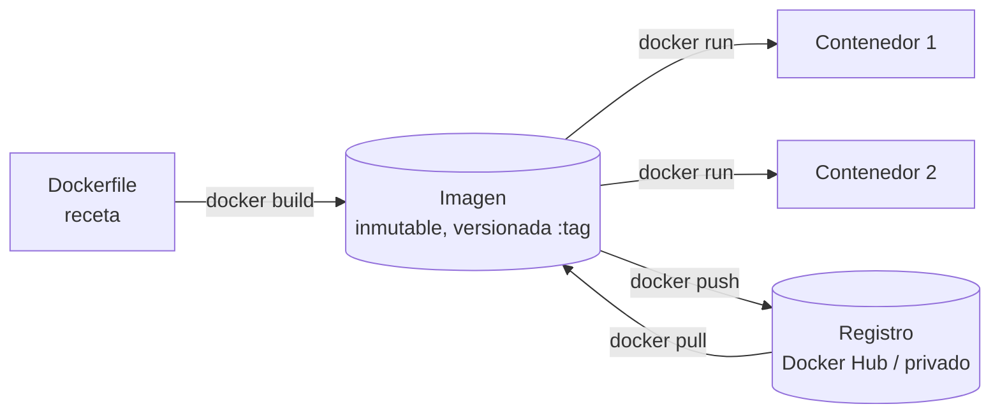
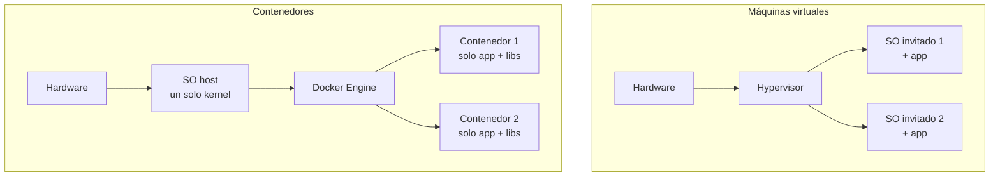
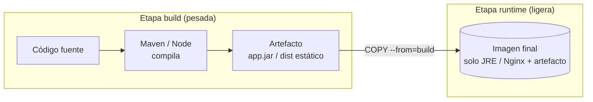
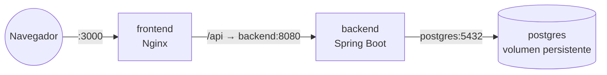
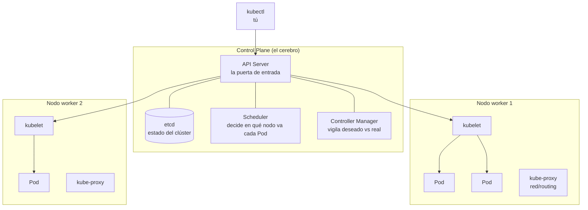
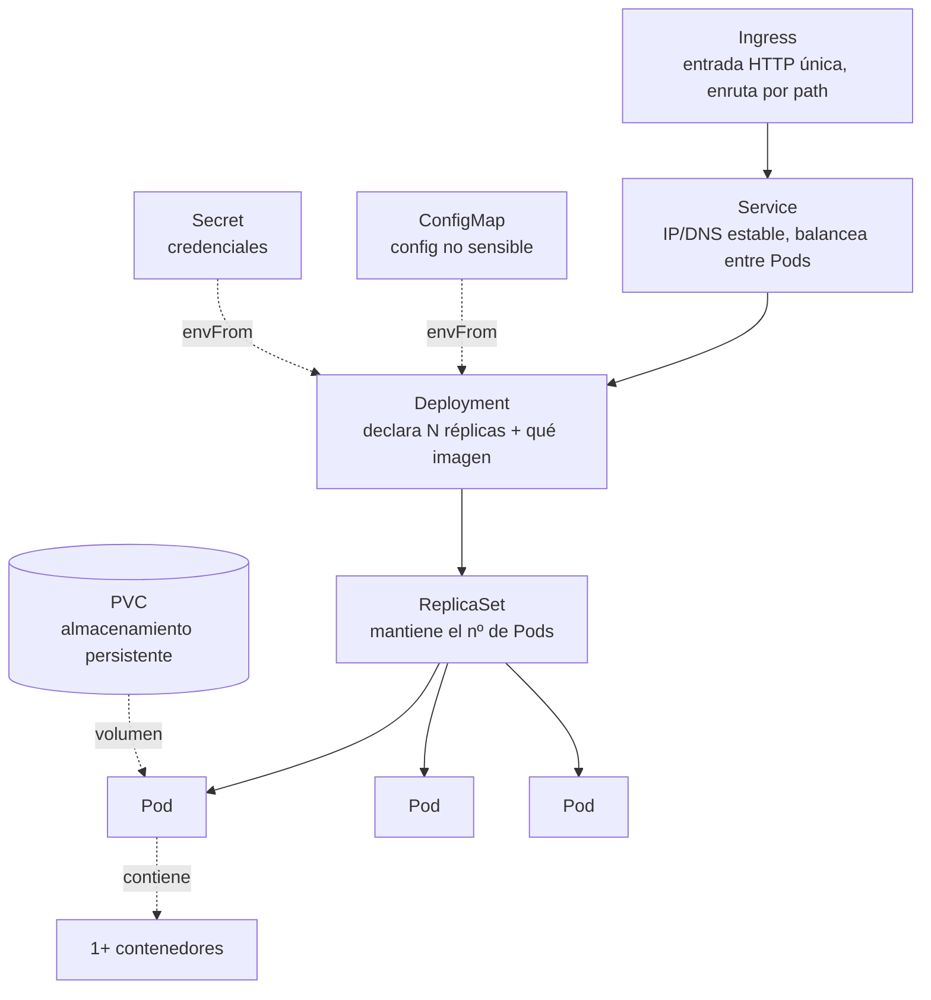
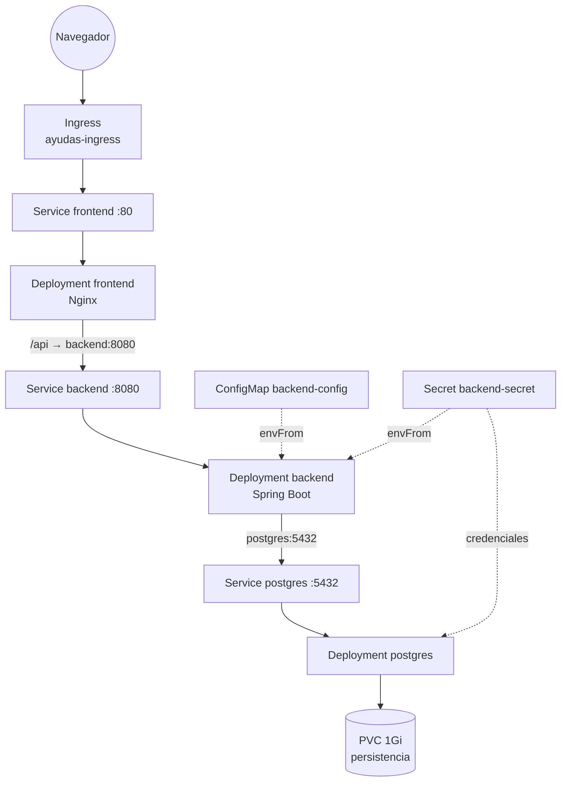
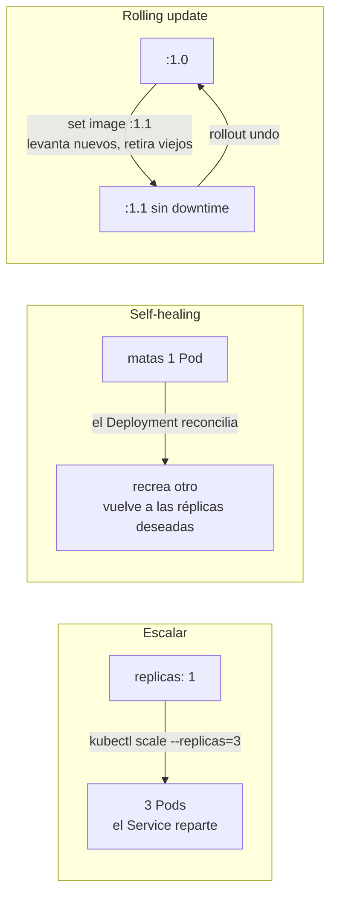

# Entrevista Docker + Kubernetes — modelo visual y preguntas

> Material de preparación para explicar Docker/Kubernetes en voz alta: primero el **modelo mental** en
> diagramas (Parte 1) y después la **batería de preguntas con respuesta modelo** de ~30 s (Parte 2).
> Todo anclado a un caso real ya montado: Ayudas GV (backend Spring Boot + frontend React/Nginx + PostgreSQL
> sobre minikube).
>
> Los diagramas son Mermaid (se renderizan en VS Code con la vista previa de Markdown, y en GitHub/GitLab).
> Diagramas del entorno en Excalidraw: [../diagramas/](../diagramas/).
>
> Consejo transversal: no recites; responde con una frase potente y remata con "lo he hecho en un proyecto
> propio". Versión con analogías cotidianas de las 6 preguntas nucleares, en
> [kubernetes-desde-0.md](kubernetes-desde-0.md) § Las seis preguntas.
>
> *Unificación de `docker-k8s-diagramas.md` + `entrevista-docker-k8s-preguntas.md` (ambos del 24/07/2026)
> en un solo documento el 28/07/2026. Contenido íntegro de los dos.*

---

# Parte 1 — El modelo visual

## 1. Qué es Docker (en una frase)

**Docker empaqueta una aplicación con todo lo que necesita para ejecutarse (código, runtime, librerías,
config) en una _imagen_ inmutable. De esa imagen se arrancan _contenedores_: procesos aislados que corren
igual en cualquier máquina.** Resuelve el "en mi máquina funciona".

- **Imagen**: plantilla de solo lectura, identificada por `nombre:tag` (ej. `ayudas-gv-backend:1.0`).
- **Contenedor**: una instancia en ejecución de una imagen. Efímero: si se borra, se pierde lo no persistido.
- **Registro**: donde se guardan/comparten las imágenes.

---

## 2. Contenedor vs máquina virtual

La diferencia clave que suelen preguntar: **el contenedor comparte el kernel del host; la VM emula un SO
completo.** Por eso el contenedor arranca en segundos y pesa MB, no GB.

---

## 3. Multi-stage build (el Dockerfile de este proyecto)

Patrón que usan ambos Dockerfiles: **una etapa compila, otra solo se lleva el resultado.** La imagen final
no arrastra Maven/Node ni el código fuente → más pequeña y más segura.

- Backend: `maven` compila el `.jar` → imagen final solo con **JRE 21** (245 MB).
- Frontend: `node` construye la SPA → imagen final solo con **Nginx** sirviendo estáticos (62,7 MB).

---

## 4. Docker Compose = varios contenedores en local

Compose describe en un YAML varios servicios que se hablan **por nombre de servicio** (DNS interno de
Docker). Esa red por nombre es la semilla mental de lo que hace Kubernetes.

> Clave para la reunión: en Compose el frontend llama a `backend` y el backend a `postgres` **por el nombre
> del servicio**, no por IP. Kubernetes hace lo mismo con los _Services_ → la transición es natural.

---

## 5. Qué es Kubernetes (en una frase)

**Kubernetes (K8s) es un orquestador: tú declaras el _estado deseado_ (cuántas réplicas, qué imagen, qué
config) y él lo mantiene** — reparte contenedores entre máquinas, los reinicia si caen, los sustituye sin
downtime y los expone por red. Docker corre un contenedor; K8s los gobierna a escala.

Las 3 cosas que definen "orquestar": **escalar, autocurar y actualizar sin caída.**

---

## 6. Arquitectura de un clúster

- **API Server**: todo pasa por aquí (`kubectl apply` habla con él).
- **etcd**: base de datos clave-valor con el estado del clúster.
- **Scheduler**: elige nodo para cada Pod nuevo.
- **Controller Manager**: bucle de reconciliación (si faltan réplicas, las crea).
- **kubelet**: agente en cada nodo que arranca los contenedores.
- En minikube todo esto vive en **un solo nodo** (control-plane + worker juntos).

---

## 7. Los objetos que usas a diario (de menor a mayor)

| Objeto | Para qué sirve | Analogía |
|--------|----------------|----------|
| **Pod** | unidad mínima: 1+ contenedores que comparten red/almacenamiento | "un contenedor" (casi siempre) |
| **Deployment** | mantiene N réplicas de un Pod y gestiona actualizaciones | "quiero 3 de esto, siempre" |
| **Service** | IP y nombre DNS estables; balancea entre las réplicas | "el teléfono fijo que no cambia" |
| **Ingress** | entrada HTTP única desde fuera, enruta por ruta/host | "la recepción del edificio" |
| **ConfigMap / Secret** | inyectar config / credenciales sin recompilar la imagen | ".env gestionado por el clúster" |
| **PVC** | almacenamiento que sobrevive a que el Pod muera | "el disco duro externo" |
| **Namespace** | separar entornos (dev/staging) en el mismo clúster | "carpetas del clúster" |

> **Por qué nunca despliegas Pods sueltos:** un Pod solo no se recupera si muere. El Deployment es quien te
> da self-healing, escalado y rolling updates. Siempre Deployment → que gestiona los Pods.

---

## 8. Este proyecto desplegado en Kubernetes (lo que montaste hoy)

Namespace `ayudas-dev`. Todo declarado en `k8s/`. Es el Compose del punto 4, pero orquestado.

- El frontend habla al backend por el Service `backend`; el backend a la BD por el Service `postgres`
  (**DNS interno**, igual que en Compose).
- Config no sensible en **ConfigMap**, credenciales en **Secret**, ambos inyectados con `envFrom`.
- La BD monta un **PVC**: si el Pod de postgres muere y se recrea, los datos siguen ahí.

---

## 9. Las 3 operaciones que definen "orquestar"

- **Escalar**: `kubectl scale deployment/backend --replicas=3`. El Service balancea solo.
- **Self-healing**: matas un Pod → el Deployment lo recrea en segundos (estado deseado). En Compose se
  quedaría caído.
- **Rolling update**: K8s levanta Pods nuevos, espera a que pasen la readinessProbe y solo entonces retira
  los viejos → cero downtime. `rollout undo` para volver atrás.

---

## 10. Docker → Kubernetes (tabla de traducción mental)

| En Docker / Compose | En Kubernetes |
|---------------------|---------------|
| `docker run` un contenedor | un **Pod** (gestionado por un **Deployment**) |
| `docker build -t img:tag` | igual; la imagen se referencia en el Deployment |
| `depends_on` + red por nombre | **Service** + DNS interno del clúster |
| puerto publicado `-p 3000:80` | **Service** (ClusterIP/NodePort) + **Ingress** para HTTP |
| bloque `environment:` | **ConfigMap** (no sensible) + **Secret** (credenciales) |
| `volumes:` | **PersistentVolumeClaim (PVC)** |
| `restart: unless-stopped` | lo da el **Deployment** (self-healing) por defecto |
| levantar todo el `docker-compose.yml` | `kubectl apply -f k8s/` |

> Frase de cierre para la reunión: *"Docker resuelve empaquetar y ejecutar un contenedor de forma
> reproducible; Kubernetes resuelve gobernarlos a escala — declaras el estado deseado y él lo mantiene:
> escala, se autocura y actualiza sin caída."*

---

# Parte 2 — Preguntas y respuestas modelo

## Cómo enfocar la reunión (antes de las preguntas)

- **Sé honesto con el nivel.** Mejor "lo he montado en un proyecto de aprendizaje de punta a punta" que
  fingir experiencia en producción. Tu ventaja: lo has hecho tú, no solo leído.
- **Ancla todo a algo real.** Cada concepto lo puedes ilustrar con lo que desplegaste: 3 servicios en un
  clúster minikube, con ConfigMap/Secret, Ingress, escalado, self-healing y rolling update.
- **Ordena la respuesta: qué es → por qué → ejemplo tuyo.** Corto. Si quieren profundizar, preguntan.
- **Si no sabes algo, dilo y reconduce:** "eso no lo he tocado en producción, pero el concepto es X y lo
  aprendería rápido porque ya domino Y".

---

## Bloque A — Docker (fundamentos)

**1. ¿Qué es Docker y qué problema resuelve?**
Empaqueta una app con todas sus dependencias en una imagen inmutable de la que se arrancan contenedores que
corren igual en cualquier máquina. Elimina el "en mi máquina funciona" y hace reproducibles los despliegues.

**2. Diferencia entre imagen y contenedor.**
La imagen es la plantilla de solo lectura (`nombre:tag`); el contenedor es una instancia en ejecución de esa
imagen. De una imagen arrancas N contenedores. El contenedor es efímero: lo que no persistas se pierde.

**3. Contenedor vs máquina virtual.**
El contenedor comparte el kernel del host y solo empaqueta la app y sus librerías → arranca en segundos y
pesa MB. La VM emula un SO completo con su kernel → pesa GB y arranca en minutos. Contenedor = aislamiento
de proceso, no de hardware.

**4. ¿Qué es un Dockerfile? ¿Qué es un multi-stage build?**
El Dockerfile es la receta para construir una imagen. Multi-stage = varias etapas: una compila (con Maven o
Node) y la final solo copia el artefacto sobre una base ligera (JRE o Nginx). Resultado: imagen más pequeña
y con menos superficie de ataque. *Ejemplo:* mi backend baja a 245 MB y el frontend a 62 MB así.

**5. ¿Qué es una capa (layer) y por qué importa el orden del Dockerfile?**
Cada instrucción crea una capa cacheable. Si pones lo que cambia poco arriba (ej. `COPY pom.xml` +
`mvn dependency`) y el código después, Docker reutiliza la caché y las builds vuelan. Cambiar una línea de
código no reinstala dependencias.

**6. ¿Qué es un volumen? ¿Y por qué un contenedor no debe guardar datos dentro?**
El contenedor es efímero; si lo borras, pierdes su sistema de ficheros. Un volumen persiste datos fuera del
ciclo de vida del contenedor. *Ejemplo:* PostgreSQL guarda su data en un volumen, no dentro del contenedor.

**7. ¿Qué es Docker Compose?**
Un YAML para levantar varios contenedores relacionados en local con un comando. Se comunican por nombre de
servicio (DNS interno de Docker). *Ejemplo:* mis 3 servicios (frontend → backend → postgres) hablan por
nombre, sin IPs fijas.

**8. ¿Cómo se comunican dos contenedores?**
Por la red de Docker, resolviendo el nombre del servicio a su IP interna. El frontend llama a `backend:8080`
y el backend a `postgres:5432` — nunca por IP. (Es exactamente lo que luego hacen los Services en K8s.)

**9. ¿Qué es un registro (registry)?**
El almacén de imágenes: Docker Hub (público) o uno privado (Harbor, ECR, GitLab Registry). `push` para subir,
`pull` para bajar. En CI/CD se construye la imagen, se etiqueta y se sube al registro que consume el clúster.

---

## Bloque B — Kubernetes (fundamentos)

**10. ¿Qué es Kubernetes y en qué se diferencia de Docker?**
Docker ejecuta contenedores; Kubernetes los orquesta a escala. Declaras el estado deseado (réplicas, imagen,
config) y K8s lo mantiene: reparte contenedores entre nodos, los reinicia si caen, escala y actualiza sin
downtime. Docker = una caja; K8s = el gobierno de muchas cajas.

**11. ¿Qué es un Pod?**
La unidad mínima desplegable: uno o más contenedores que comparten red y almacenamiento. Casi siempre un Pod
= un contenedor. Los Pods son efímeros y desechables; no te "encariñas" con uno.

**12. Pod vs Deployment vs Service (la pregunta estrella).**
El **Pod** ejecuta los contenedores. El **Deployment** declara cuántas réplicas de ese Pod quieres y gestiona
su ciclo (self-healing, escalado, rolling update). El **Service** da una IP y un nombre DNS estables y
balancea el tráfico entre las réplicas, aunque los Pods cambien de IP.

**13. ¿Por qué no despliegas Pods sueltos?**
Un Pod solo no se recupera si muere. El Deployment mantiene el número deseado de réplicas, te da self-healing,
escalado y actualizaciones controladas. Regla: siempre Deployment, que gestiona los Pods.

**14. Tipos de Service: ClusterIP vs NodePort vs LoadBalancer.**
**ClusterIP** (por defecto): solo accesible dentro del clúster — para comunicación interna. **NodePort**:
abre un puerto en cada nodo — acceso externo básico. **LoadBalancer**: pide un balanceador al proveedor cloud
— acceso externo en producción. *Ejemplo:* mis 3 Services son ClusterIP; la entrada la da el Ingress.

**15. ¿Qué es un Ingress y en qué se diferencia de un Service?**
El Service expone un Pod dentro (o a bajo nivel fuera) del clúster; el Ingress es una entrada HTTP única que
enruta por ruta o host hacia varios Services (`/` → frontend, `/api` → backend). Una sola puerta, reglas L7.

**16. ConfigMap vs Secret.**
Ambos inyectan config en los Pods sin recompilar la imagen. El **ConfigMap** es para config no sensible
(URLs, puertos); el **Secret**, para credenciales (se guarda en base64 y con control de acceso). *Ejemplo:*
`DB_URL` en ConfigMap; `DB_PASSWORD` y `JWT_SECRET` en Secret, ambos con `envFrom`.

**17. ¿Qué es un Namespace?**
Una partición lógica del clúster para separar entornos o equipos (dev/staging/prod) con el mismo stack y
distinta config. *Ejemplo:* `ayudas-dev` y un futuro `ayudas-staging` con el mismo despliegue y otro ConfigMap.

**18. ¿Qué son las probes: liveness vs readiness?**
La **readiness** dice si el Pod está listo para recibir tráfico (si no, el Service no le manda peticiones).
La **liveness** dice si sigue vivo (si falla, K8s lo reinicia). *Ejemplo:* mi backend tarda por Spring Boot +
Flyway, así que le puse un `initialDelaySeconds` generoso para que la liveness no lo mate durante el arranque.

**19. ¿Qué es el "estado deseado" y la reconciliación?**
Tú declaras cómo quieres que esté el sistema (ej. 3 réplicas de la imagen X); un bucle de controladores
compara el estado real con el deseado y actúa hasta igualarlos. Si matas un Pod, lo recrea. Es el corazón
de K8s: describes el destino, no los pasos.

**20. ¿Cómo persiste datos una BD en K8s? ¿Deployment o StatefulSet?**
Con un **PVC** (PersistentVolumeClaim) que sobrevive al Pod. Un backend stateless se replica sin problema con
un Deployment; una BD con un PVC `ReadWriteOnce` **no** se puede replicar igual (un solo escritor), por eso
las BBDD usan **StatefulSet** (identidad estable y almacenamiento por réplica). *En mi caso*: postgres como
Deployment de 1 réplica con PVC, sabiendo que en producción sería StatefulSet.

---

## Bloque C — Operar (escalar, autocurar, actualizar)

**21. ¿Cómo escalas una aplicación?**
`kubectl scale deployment/backend --replicas=3` (o subiendo `replicas` en el manifiesto). El Service reparte
el tráfico entre las 3 réplicas automáticamente; no toco frontend ni DNS. Para auto-escalar por carga, un HPA.

**22. Explica self-healing.**
Si un Pod muere, el Deployment detecta que el estado real (2 réplicas) no coincide con el deseado (3) y crea
otro en segundos. *Lo he probado*: `kubectl delete pod` y el Deployment lo recrea sin que el frontend se
entere. En Compose el contenedor se quedaría caído.

**23. ¿Qué es un rolling update y cómo haces rollback?**
Actualización sin downtime: K8s levanta Pods con la imagen nueva, espera a que pasen la readiness y solo
entonces retira los viejos. `kubectl set image ...` lo lanza; `kubectl rollout status` lo sigue; y
`kubectl rollout undo` vuelve a la versión anterior si algo falla.

**24. Se cae la app en producción. ¿Cómo lo diagnosticas?**
`kubectl get pods` para ver el estado (CrashLoopBackOff, ImagePullBackOff...), `kubectl describe pod` para los
eventos (probes, scheduling) y `kubectl logs` para el error de la app. *Lo he practicado*: rompí a propósito
la contraseña de la BD en el Secret y lo diagnostiqué con logs (`FATAL: password authentication failed`).

**25. ¿Qué es ImagePullBackOff y CrashLoopBackOff?**
**ImagePullBackOff**: no puede descargar la imagen (tag mal, registro inaccesible, o —en minikube— la imagen
no está en el Docker del nodo). **CrashLoopBackOff**: el contenedor arranca y se cae en bucle (suele ser un
error de la app o de config). *Ejemplo:* al construir la imagen fuera del Docker de minikube, el Pod quedaba
en ImagePullBackOff hasta construirla dentro.

**26. ¿Qué son requests y limits de recursos?**
`requests` = lo que el Pod tiene garantizado (lo usa el scheduler para colocarlo); `limits` = su techo. Si
supera el límite de **memoria**, lo matan (OOMKilled); si supera el de **CPU**, lo frenan (throttling), no lo
matan. Ponerlos evita que un Pod ahogue a los vecinos.

---

## Bloque D — Práctica, arquitectura y CI/CD

**27. ¿Cómo llega una imagen de tu código a un clúster? (flujo CI/CD)**
Commit → pipeline construye la imagen y la etiqueta (ej. con el hash o versión) → la sube a un registro →
`kubectl apply`/`set image` actualiza el Deployment, que hace rolling update. La versión de la imagen es la
unidad de despliegue.

**28. ¿Cómo encaja Kubernetes con microservicios?**
Cada microservicio es un Deployment + un Service; un gateway (o el Ingress) reparte el tráfico por ruta. Se
escala y despliega cada servicio de forma independiente. *En mi proyecto* el plan es extraer del monolito
`ms-tramitacion`, `ms-expedientes`, etc., cada uno con su Deployment/Service.

**29. ¿Qué es Helm? (aunque no lo hayas usado a fondo)**
Un gestor de paquetes para K8s: plantillas parametrizables (charts) que evitan duplicar manifiestos por
entorno. Si tienes dev/staging/prod, Helm te da un solo chart con `values` distintos. (Honesto: lo conozco a
nivel de concepto; he trabajado con manifiestos YAML directos.)

**30. ¿Minikube vale para producción?**
No: minikube es un clúster local de un nodo para aprender y desarrollar. En producción se usa un clúster
gestionado (EKS, GKE, AKS) o autogestionado multi-nodo, con alta disponibilidad del control plane. Lo que
aprendes en minikube (objetos, kubectl, manifiestos) es transferible tal cual.

---

## Preguntas que TÚ puedes hacer (demuestran criterio)

Hacer buenas preguntas en la reunión te posiciona como alguien que ya piensa en el día a día real:

- ¿Qué clúster usáis — gestionado (EKS/GKE/AKS) o propio? ¿Cuántos entornos (dev/staging/prod)?
- ¿Cómo es el pipeline de despliegue: quién hace el `apply`, usáis GitOps (Argo CD / Flux) o CI clásico?
- ¿Gestionáis los manifiestos con Helm, Kustomize o YAML directo?
- ¿Cómo lleváis la observabilidad — logs centralizados, Prometheus/Grafana, alertas?
- ¿Cómo manejáis los secretos (Sealed Secrets, Vault, secretos del proveedor cloud)?
- ¿Las bases de datos van dentro del clúster (StatefulSet) o gestionadas fuera (RDS/Cloud SQL)?
- ¿Qué parte del stack tocaría yo primero y cómo es el onboarding?

---

## Chuleta de comandos (por si preguntan "cómo harías X")

| Necesito | Comando |
|----------|---------|
| Ver el estado de los Pods | `kubectl get pods -o wide` |
| Ver por qué un Pod falla | `kubectl describe pod <nombre>` |
| Ver los logs de la app | `kubectl logs -l app=backend --tail=50` |
| Entrar a un Pod | `kubectl exec -it deploy/backend -- sh` |
| Escalar | `kubectl scale deployment/backend --replicas=3` |
| Actualizar imagen (rolling) | `kubectl set image deployment/backend backend=img:1.1` |
| Seguir el despliegue | `kubectl rollout status deployment/backend` |
| Deshacer | `kubectl rollout undo deployment/backend` |
| Aplicar manifiestos | `kubectl apply -f k8s/` |
| Ver Services y sus IPs | `kubectl get svc` / `kubectl get endpoints <svc>` |

> Recuerda: **qué es → por qué → "lo he hecho en un proyecto propio de punta a punta"**. Esa última frase,
> dicha con naturalidad, vale más que cualquier definición memorizada.
